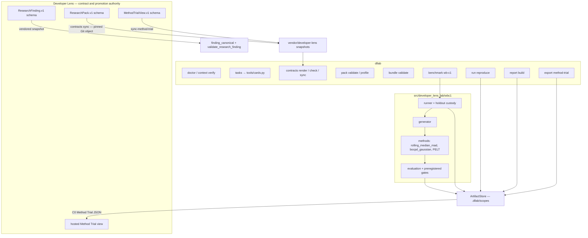

# Developer Lens Lab

A local-first evaluation engine that runs invented change-point experiments and keeps the rejection on the record.

[](https://github.com/Chris0Jeky/developer-lens-lab/actions/workflows/check.yml)
[](https://github.com/Chris0Jeky/developer-lens-lab/actions/workflows/context-compat.yml)
[](pyproject.toml)
[](LICENSE)

## What this is

This is the public research companion to [Developer Lens](https://github.com/Chris0Jeky/developer-lens). Developer Lens stays the product, the canonical-contract owner, and the only path to stable-channel promotion. The Lab owns invented research packs, reproducible experiments, candidate evaluation, and the evidence when a method loses.

I built it to answer one question without theatre: does a statistical or machine-learning method add system-level decision value, or does the complete deterministic fallback still win? A green test here never installs a model over there. An EvaluationBundle can say `reject`, `revise_once`, or `benchmarked`. It cannot say `ship`.

The public surface is C0 invented data. Network collection, real or private inputs, external model calls, credentials, and product promotion stay closed. Constitution v2 authorises some of those lanes in principle; none of them open until the activation preconditions in [`.agent-harness/governor.json`](.agent-harness/governor.json) are mechanically true.

I am Chris ([Chris0Jeky](https://github.com/Chris0Jeky)), a London backend, platform, and DevSecOps engineer. The Lab is local-first on purpose: run it from a clone, write artifacts under ignored `.dllab`, and keep real repositories and secrets out of Git.

## Features

What the clone actually does today:

- **`dllab` CLI.** Typer entry point from [`src/developer_lens_lab/cli.py`](src/developer_lens_lab/cli.py): `doctor`, `context`, `tasks`, `contracts`, `pack`, `bundle`, `benchmark`, `run`, `report`, `export`, and `demo`.
- **Authority checks.** `dllab doctor` and `dllab context verify` fail when required files, local markdown links, generated schemas, or governor/prompt parity drift.
- **Task programme.** `tools/cards.py` is the only card source. `dllab tasks check` and `dllab tasks render` keep [`docs/CARD_INDEX.md`](docs/CARD_INDEX.md) honest.
- **Pinned contracts.** Strict readers for `DeveloperLensResearchPack.v1` and `DeveloperLensEvaluationBundle.v1`. Lab-owned schemas are generated; product schemas are vendored snapshots, never hand-edited.
- **Product sync as provenance, not a join key.** `dllab contracts sync` and `dllab contracts sync-method-trial` copy fixed schema and fixture paths from a pinned Developer Lens Git object and record commit plus byte checksums.
- **Pack and bundle validation.** `dllab pack validate` / `profile` and `dllab bundle validate`. Missing relations stay `present`, `absent`, `unsupported`, or `intentionally_omitted`. Missing is never coerced to zero.
- **Content-addressed artifact store.** Scope-local objects under `.dllab/scopes/<opaque-id>/objects/`. Manifests carry `{sha256, size_bytes, media_type}` only. Run IDs are single-use; a second process cannot reopen the same experiment.
- **WB-C1 invented weekly-series benchmark.** Generator covers no-change controls; level, variance, slope, and seasonal-amplitude changes; Gaussian and heavy-tailed noise; missing blocks; and coverage, permission, and parser-shift confounders with no system change.
- **Symmetric methods, honest roles.** Rolling median/MAD baseline; fixed-prior Gaussian BOCPD candidate; PELT as offline descriptive localisation only. Thresholds are selected inside training; test and final holdout cannot influence that choice.
- **Holdout custody.** The runner writes an append-only custody record before the final holdout materialises.
- **Byte-reproducible replay.** `dllab run reproduce` recomputes the run and compares recorded artifact bytes.
- **Reports and Method Trial export.** `dllab report build` writes deterministic Markdown and HTML. `dllab export method-trial` projects one validated smoke run into the product-owned `DeveloperLensMethodTrialView.v1` view. `dllab demo export` is the same exporter with an explicit `--output`.
- **Research-finding transport, validation only.** The Lab can validate the product-owned `ResearchFindingProjection.v1` snapshot. A `dllab export finding` command is [planned](https://github.com/Chris0Jeky/developer-lens-lab/issues/97), not shipped.

What it does **not** do: collect GitHub corpora, read credentials, call external models, ingest real repositories, or promote a method into Developer Lens.

## Architecture



WB-C1 smoke is the runnable vertical. The runner materialises invented `coverage` and `repository_week` Parquet relations under the pinned product schema, evaluates the online arms, records PELT only as offline evidence, and emits an EvaluationBundle. The reviewed C0 exhibit decided `reject`: the candidate did not beat the baseline on false alerts per year, both threshold selections were nonviable, and the deterministic fallback stayed complete. That is mechanics evidence, not a claim about real repositories. See [`docs/EXPERIMENT_LEDGER.md`](docs/EXPERIMENT_LEDGER.md) and [`CHANGELOG.md`](CHANGELOG.md).

## Quickstart

Install [uv](https://docs.astral.sh/uv/) 0.12.x. Python 3.12 or 3.13. Run from a clone of this repository.

```powershell
uv sync --locked --all-groups
uv run dllab doctor
uv run dllab context verify
uv run dllab tasks check
uv run dllab contracts check
uv run dllab pack validate vendor/developer-lens/research-pack/v1/invented.fixture.json
uv run dllab pack profile vendor/developer-lens/research-pack/v1/invented.fixture.json
uv run pytest
```

The product fixture used above is a compatibility canary and may omit every relation. That is intentional.

WB-C1 needs a clean tracked/unignored worktree because the run records the executing lab commit:

```powershell
uv run dllab benchmark wb-c1 --smoke
uv run dllab run reproduce wbc1_smoke
uv run dllab report build wbc1_smoke
uv run dllab export method-trial wbc1_smoke
```

Default smoke identity is `wbc1_smoke`. The command writes an ignored, content-addressed run under `.dllab/scopes/wbc1_smoke/`. Use `--run-id <new_opaque_id>` for another run; the scope is single-use. `run reproduce` verifies stored objects, then regenerates and byte-compares them. Use `uv run dllab benchmark wb-c1 --full` only for the larger opt-in lane. The `--full` lane keeps generic EvaluationBundle reports and replay; it does not record a smoke-only Method Trial projection.

`export method-trial` reads one already validated local smoke run, selects the no-change, planted-change, and instrumentation-confound windows deterministically, validates the product schema plus the lab's equivalent cross-field rules, and writes ignored `method-trial-view.json` by default. It does not send a request, expose system aliases, install a model, or add an EvaluationBundle parser to the product.

The M1 contract vertical is runnable without a collector or dataset. Contract sync needs a local Developer Lens checkout and a 40-hex commit:

```powershell
uv run dllab contracts sync --from path\to\developer-lens --ref <40-hex-commit>
uv run dllab contracts sync-method-trial --from path\to\developer-lens --ref <40-hex-commit>
```

`contracts sync` reads only the fixed ResearchPack schema and invented-fixture paths from the pinned Git object. `contracts sync-method-trial` reads only the product-owned `DeveloperLensMethodTrialView.v1` structural schema and requires its structural-only annotation. A JSON Schema pass alone is not artifact acceptance.

The full code/config milestone gate lives in [`CLAUDE.md`](CLAUDE.md): format, lint, types, pytest, MkDocs `--strict`, and `scripts/verify_hygiene.py`.

## Tech stack

From [`pyproject.toml`](pyproject.toml) and the imports in `src/developer_lens_lab/`:

| Layer | What the Lab uses |
| --- | --- |
| Language | Python 3.12 or 3.13 (`requires-python = ">=3.12,<3.14"`) |
| Packaging | uv `>=0.12.2,<0.13`, hatchling, locked [`uv.lock`](uv.lock) |
| CLI | Typer |
| Contracts | Pydantic v2, jsonschema Draft 2020-12 |
| Series and methods | NumPy, SciPy, [ruptures](https://centre-borelli.github.io/ruptures-docs/) PELT |
| Artifacts | PyArrow Parquet, orjson for finding canonicalisation |
| Authority docs | PyYAML |
| Proof | pytest, ruff, pyright (strict), Hypothesis, MkDocs Material |

The lock also pins DuckDB, Polars, scikit-learn, statsmodels, httpx, and Rich. Those are declared dependencies; the Lab package does not import them today. Do not read that list as a feature claim.

CI is two workflows on `pull_request` and `push` to `main`: [Prove the lab](.github/workflows/check.yml) and [Context compatibility](.github/workflows/context-compat.yml) on Python 3.12 and 3.13.

## Status and roadmap

Package identity is `developer-lens-lab` `0.1.0` (`Development Status :: 3 - Alpha`). There is no Git tag, no PyPI upload, and no published GitHub Release. [`CHANGELOG.md`](CHANGELOG.md) is release-note preparation, not a tag.

Runtime and tracked inputs remain C0 invented. The current cards (`tools/cards.py`):

| State | Card | Meaning |
| --- | --- | --- |
| ACTIVE | `LAB-REL-01` ([issue #29](https://github.com/Chris0Jeky/developer-lens-lab/issues/29)) | v0.1.0 release wave. Lab-side prep is in-tree; the joint tag waits on product visual QA and `Chris0Jeky/developer-lens::HUMAN_TODO.md::q-10(c)`. |
| BACKLOG | `LAB-ACT-01` | Real-data activation preconditions. Closed until `.agent-harness/governor.json` is mechanically true plus owner scope at `HUMAN_TODO.md` q-9. |
| BACKLOG | `LAB-SURV-01` ([issue #30](https://github.com/Chris0Jeky/developer-lens-lab/issues/30)) | Integration-tail survival study. Depends on a later product-owned view. |
| BACKLOG | `LAB-CONTRACT-03` ([issue #23](https://github.com/Chris0Jeky/developer-lens-lab/issues/23)) | MethodTrialView representative-preference reconcile. Product-owned schema change. |
| BACKLOG | `LAB-CORPUS-01` … `03` | Public-metadata corpus. Parked behind `LAB-ACT-01`. |
| Planned | [issue #97](https://github.com/Chris0Jeky/developer-lens-lab/issues/97) | `dllab export finding` for the stored research-finding projection. |

Milestones M0–M2 (repository OS, contracts, WB-C1 smoke) are implemented. M3 corpus, M4 empirical candidate, and M5 product proposal stay gated. Deferred security and operational debt lives in [`docs/HARDENING_BACKLOG.md`](docs/HARDENING_BACKLOG.md); it does not block the runnable C0 loop.

Owner-only gates that remain open are listed in [`HUMAN_TODO.md`](HUMAN_TODO.md): AGPL/CLA legal review (q-7), any real-study public transformation (q-8), real-data scopes (q-9), remote telemetry destination (q-10), umbrella brand (q-12), and two escaped-environment cleanups (q-13). Small fixes and issue discussion may proceed. Substantial external code waits on q-7. There is no CLA in this repository.

## Boundaries

- Analytical subjects on the public surface are repositories, software systems, collection instruments, and aggregate time windows. Person-level research is constitutionally layered and is not active on this C0 surface.
- Invented fixtures may be tracked. Datasets, Parquet outputs, local artifact objects, credentials, real repository allowlists, and generated run outputs may not be committed.
- Missing, unavailable, censored, restricted, or intentionally omitted evidence is explicit and is never converted to zero.
- Secrets are prohibited absolutely: tokens, credentials, private keys, and confidently detected secret material are rejected before every sink.
- A candidate can be rejected. Nothing installs itself into Developer Lens.
- `.dllab` stores scope-local content-addressed objects. Manifests contain digests and controlled metadata, not filesystem paths.
- Third-party ResearchPack producers remain closed pending product-side hardening.

Read [`docs/PRODUCT_BOUNDARY.md`](docs/PRODUCT_BOUNDARY.md), [`docs/DATA_POLICY.md`](docs/DATA_POLICY.md), and [`docs/CONTRACTS.md`](docs/CONTRACTS.md) before changing a contract, artifact, corpus, persistence, or evaluation seam.

## License and contributing

Developer Lens Lab is copyright (C) 2026 Cristian Tcaci and is released under the GNU Affero General Public License v3.0 only (`AGPL-3.0-only`). See [LICENSE](LICENSE). The Python package name is `developer-lens-lab`; the command is `dllab`.

A future commercial option may be considered. None is offered today, and there is no public dual-licensing promise. See [`COMMERCIAL_OPTION.md`](COMMERCIAL_OPTION.md).

Contribution rules, invented-data requirements, and the q-7 external-code gate are in [`CONTRIBUTING.md`](CONTRIBUTING.md). Conduct expectations and the content-free private-contact request are in [`CODE_OF_CONDUCT.md`](CODE_OF_CONDUCT.md). The Lab has no dedicated conduct inbox and no published incident address.

Staged C0 Method Trial bytes under [`release-assets/v0.1.0/method-trial-v1/`](release-assets/v0.1.0/method-trial-v1/) are tracked for release review only (`staged_for_release_review_only`). Staging is not publication.

## Links

- [Developer Lens](https://github.com/Chris0Jeky/developer-lens) — product and contract authority
- [Product Method Trial view](https://chris0jeky.github.io/developer-lens/?view=method-trial) — hosted C0 exhibit of the rejected WB-C1 story; not a Lab-hosted demo
- [Owner constitution](docs/OWNER_CONSTITUTION.md)
- [Research programme](docs/RESEARCH_PROGRAMME.md)
- [Reproducibility](docs/REPRODUCIBILITY.md)
- [Roadmap](docs/ROADMAP.md) and [card index](docs/CARD_INDEX.md)
- [Issues](https://github.com/Chris0Jeky/developer-lens-lab/issues) and [Discussions](https://github.com/Chris0Jeky/developer-lens-lab/discussions)
- [License](LICENSE)
